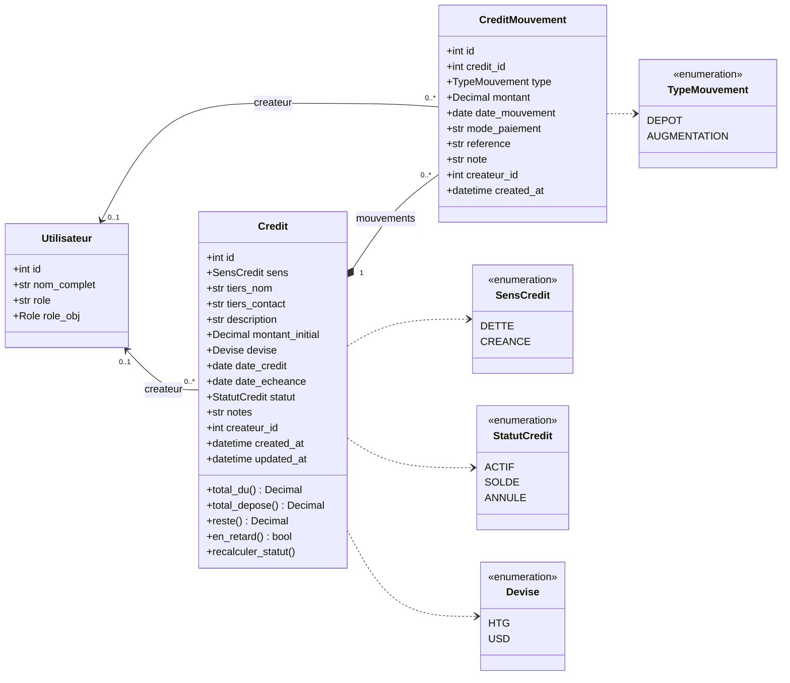

# Module Crédits — Diagramme de classes UML

## Règles métier

- `total_du = montant_initial + Σ AUGMENTATION`
- `reste = total_du − Σ DEPOT` (calculé, jamais stocké)
- Un DEPOT ne peut pas dépasser le reste ; sa date ne peut pas précéder `date_credit`.
- Statut : `SOLDE` automatiquement quand `reste = 0`, `ACTIF` sinon ; `ANNULE` uniquement manuel (exclu des totaux).
- Suppression d'un crédit en cascade sur ses mouvements (composition).
- `en_retard = statut ACTIF et date_echeance < aujourd'hui`.

## Implémentation (bpccp)

- Modèles : `backend/models.py` (`Credit`, `CreditMouvement`, tables `credits` et `credit_mouvements`).
- API : `backend/credits_routes.py` (`/api/credits`), réservée à la direction.
- Page : « Crédits » dans `frontend/index.html` (section Gestion).
- Ajouts au diagramme : retrait d'un mouvement saisi par erreur et suppression d'un crédit avec motif
  obligatoire (journal d'audit) ; totaux toujours séparés par devise (HTG et USD jamais additionnés).
- Tests : `backend/tests/test_credits.py`.
